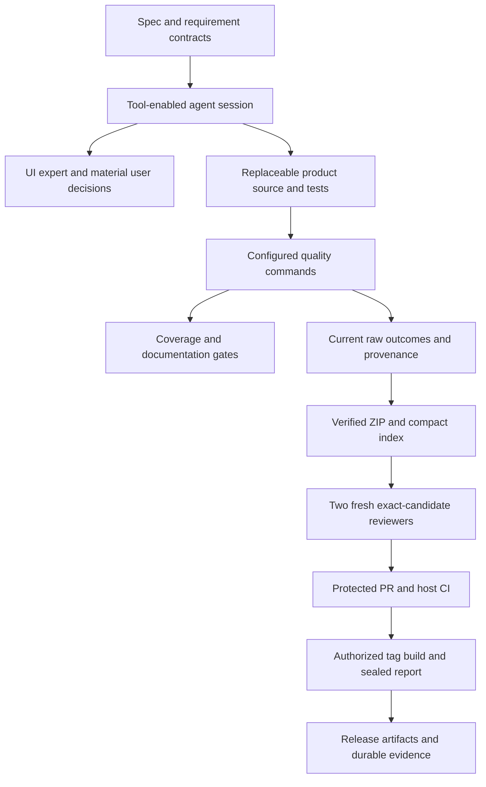

# Architecture and ownership

| Owner | Responsibility |
| --- | --- |
| project.json / tools/project.py | Project identity, argument-array gates/builds, source fingerprints |
| src/ and tests/ | Replaceable reference CLI and observable acceptance |
| tools/quality.py / run_tests.py | Raw command logs, structured outcomes and current-source checks |
| tools/coverage.py / check_requirements.py | Concrete mapping, dimensions, gaps, canonical test fingerprints |
| tools/check_docs.py | Local document links and Spec Kit baseline shape |
| tools/review_gate.py / .githooks/pre-push | Canonical candidate digest and two-record validation |
| tools/evidence.py | Byte-preserving capture, safe names and manifest/ZIP verification |
| tools/release.py | Current quality/build, report/archive/checksums, pre-publication validation |
| tools/bootstrap.py | Explicit local identity setup and authorized remote protection |
| .agents/skills/ | Spec-first, UI preflight and final independent review routing |

The agent session orchestrates reviews and user decisions. Actions executes
deterministic checks; no model credential or automatic reviewer identity service
is hidden inside CI. Attestations describe actual session reviews but cannot
authenticate identity/independence. Repository writers/admins can alter policies;
branch protection is an operational gate, not a malicious-admin security boundary.

Keep product state/ownership diagrams here as the product grows, and user-visible
flows in the owning feature contract. Render and inspect changed Mermaid diagrams;
compare semantics against source. Syntax success alone does not prove accuracy.

## Graph and reference ownership

| Owner | Responsibility |
| --- | --- |
| graph_common.py | Mandatory text input allowlist, exclusions, budgets and tool versions |
| graph_first.py / graph_worker.py | Client hook protocol, locks/freshness, CRG incremental parsing and bounded navigation |
| install_graph_first.py | Explicit backed-up idempotent user configuration and discoverable skills |
| graph_release.py / release.py | Release-only Graphify AST, structural document links and sealed snapshot validation |
| ui_reference.py / docs/ui-reference | Latest approved screen/state assets and source/image freshness gate |

The [owning feature flow](specs/graph-first.md#feature-flow) separates current CRG
from immutable release graph context and human/agent-approved visual references.
No repo-controlled hook commands or model billing are introduced by indexing.

~~~mermaid
flowchart TB
    Claude[Claude Code events] --> Runtime[Shared installed user hook]
    Codex[Codex events and native trust] --> Runtime
    Runtime --> Policy[Curated input hashes and budgets]
    Policy --> Worker[Serialized bounded CRG parser worker]
    Worker --> Cache[Root-isolated SQLite and freshness marker]
    Cache --> Context[Bounded locations and neighbor context]
    Release[Reviewed clean tagged release] --> Corpus[Tracked eligible source and documents]
    Corpus --> Graphify[Local Graphify AST and explicit document links]
    Graphify --> Seal[Graph ZIP and manifest in validated release package]
    Sources[Relevant UI sources and approved captures] --> Reference[Catalog source and image integrity gate]
~~~
