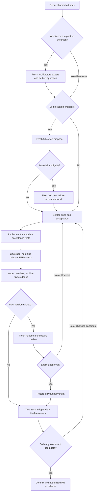

# Development workflow

Use [coding practice](CODING_PRACTICE.md) for the focused daily loop: targeted
iteration, complete candidate checks, evidence reuse, safe parallel work and one
final candidate freeze. This page continues to own UI decisions and delivery.

## Architecture before implementation

Every task reads the [code/component map and feature atlas](architecture/README.md)
and records architectural impact in its change record before implementation.
For a clearly local change, record N/A and a short source-based reason. Possible
changes to ownership, process/thread boundaries, IPC/API contracts, lifecycle,
queues, persistence/migration, shared input/geometry, security/privacy, dependencies,
build topology or release/evidence bindings require the
[architecture-review skill](../.agents/skills/architecture-review/SKILL.md) and a
fresh read-only architecture expert first. Uncertain impact triggers review.

The expert inspects current source/tests/diagrams and returns affected owners and
invariants, current/proposed overview and sequence, alternatives/tradeoffs,
failure/cancel/stale/rollback/teardown paths, compatibility and verification scope,
and an explicit approve-approach, changes-needed or unresolved-questions conclusion.
Record identity/scope/findings/decision in the existing change record. Resolve
blockers and consequential unclear requirements before dependent work; use the
existing user-clarification policy. Ordinary authorized technical choices need no
additional permission. Re-review material implementation departures.

Maintain a source-linked system/component map and overview plus sequence for each
feature owner. Use [the architecture page template](templates/feature-architecture.md).
Label diagrams as current implementation, intended contract, debug-only or planned;
keep failures and verification limits visible. Render/inspect changed diagrams for
readability and source agreement. Record material lasting decisions as small ADRs
with alternatives/consequences; avoid an ADR for routine edits. The expert preflight
is separate from UI review, rendered acceptance and both fresh final reviewers.
It is an agent-session policy, not a new CI service that authenticates judgment.

Write the observable behavior in SPEC.md and its owning feature contract before
code. Reconcile stable requirement IDs, scenarios and gaps. For UI work, invoke
the [UI expert skill](../.agents/skills/ui-review/SKILL.md). Give the fresh read-only
expert the request, current flow, spec/design, constraints and actual captures;
label missing/historical captures. Review whole tasks: discovery, actions,
preserved capabilities, navigation/recovery, loading/error/disabled feedback,
keyboard/focus/accessibility, constrained bounds and all affected surfaces.

Present a recommendation, before/after task steps, meaningful states/tradeoffs,
and an annotated sketch when placement/navigation changes. Wait for material
user decisions; clarify consequential uncertainty after expert review unless
explicitly delegated. Exact specified corrections need only a brief proposal,
not repeated approval. Silence/expert preference is not the user's decision.
Continue independent work while dependent work waits. Record expert identity,
scope, proposal, actual user answer or prior authorization and resulting criteria
in the change record. Revisit material implementation departures.

Implement shared behavior/state/style, then add or update behavior-focused tests.
Every test-source edit reconciles concrete requirement checks and refreshes both
coverage files. Render changed diagrams and inspect them against source. Run
host gates and applicable integration/E2E/device checks sequentially where they
share mutable targets. Fix causes; document exclusions without claiming a full
Cartesian scenario matrix. Proposal approval, actual renders, golden acceptance
and measured performance are separate evidence.

Archive according to [evidence policy](EVIDENCE.md), then stage the complete tree.
Create exactly two fresh final reviewers with no inherited history. They receive
the candidate/spec/tests/raw evidence and review instructions independently, not
the author's conclusions or each other's verdicts. Both must explicitly approve
the same digest. Resolve blockers, reverify and get a NEW pair after any content
change. Record identities/timestamps/scope and run [the gate](REVIEWS.md).

Commit/push/merge/release only within user authorization and protected-main policy.
The upstream UI expert cannot substitute for either final reviewer. If agents
are unavailable, finish local work and report the missing gate; never synthesize
approvals. GitHub CI checks attestations and deterministic gates; this repository
does not provide an unauthenticated unattended AI service. Enable agents in your
own supported environment. No API subscription/key is installed. Global hooks are an explicit optional
local setup step. [OpenAI agent instructions](https://learn.chatgpt.com/docs/agent-configuration/agents-md),
[skills](https://learn.chatgpt.com/docs/build-skills) and
[subagents](https://learn.chatgpt.com/docs/agent-configuration/subagents) describe the
Codex integration; equivalent independent agent tools can follow this protocol.

Only create a Codex Goal when explicitly requested. Use a bounded objective,
completion checks and the existing authorization scope; policy stays in Git.

## Current graph and visual context

Use [graph-first hooks/skill](GRAPH_FIRST.md) for coding and independent review.
CRG updates during development with bounded diagnosed fallback. Graphify updates
only in authorized release builds, excluding evidence/local config/images.
For UI work inspect and reconcile [latest approved master views](ui-reference/README.md)
against actual renders before final review. Historical test captures remain archived.

## Every release candidate

After completed checks/evidence, every new version needs fresh architecture
approval before the two final reviewers, even for task N/A, patches, prereleases
and docs-only. Inspect cumulative release changes and current architecture;
record actual verdict/findings/gaps against the exact pre-attestation snapshot.
Only faithful attestation may be added before final reviewers approve the full
canonical candidate. Missing approval/blockers stop tag/push/dispatch/sign/publish.
See [release architecture review](RELEASING.md#release-architecture-review) for
binding, freshness/retry rules and the distinction from existing automated CI.
