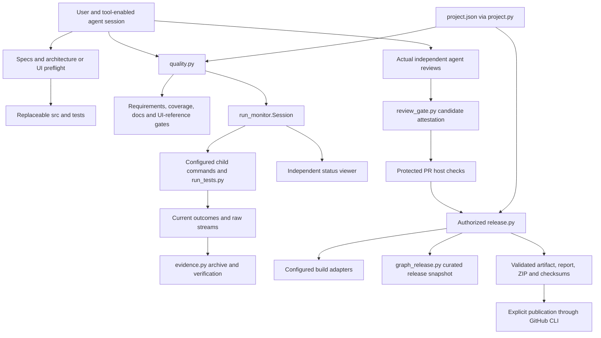

# Code overview and feature architecture

Use this map before choosing implementation files. The template contains a
replaceable CLI and workflow tools, not DexDroid or an unattended AI agent service.
[Architecture](../ARCHITECTURE.md) owns boundaries; [feature contracts](../specs/README.md)
and [SPEC](../../SPEC.md) own requirements. Diagrams map current source/intended
contracts, not proof that an adopting project's features have passed testing.

## Components and boundaries

The agent session makes design/review decisions. Local tools and Actions run
configured commands; CI validates records and outcomes, not reviewer identity.
Child processes are owned/bounded by the supervisor. Publication, local user-hook
installation and GitHub protection are explicit external boundaries.

| Source owner | Responsibility and state |
| --- | --- |
| [src/example.py](../../src/example.py) | Replaceable name-validation/greeting CLI, no persistent state |
| [project.py](../../tools/project.py) and [project.json](../../project.json) | Validated identity, argument arrays, artifact config and eligible source fingerprints |
| [quality.py](../../tools/quality.py) and [run_tests.py](../../tools/run_tests.py) | Current checks and structured real case outcomes bound to source commit |
| [run_monitor.py](../../tools/run_monitor.py) | Owned child process trees, raw streams, bounded status and independent viewer |
| [coverage.py](../../tools/coverage.py), [check_requirements.py](../../tools/check_requirements.py), [check_docs.py](../../tools/check_docs.py) | Mapping/fingerprint freshness and document integrity, not semantic review |
| [evidence.py](../../tools/evidence.py) | Immutable safe ZIP/member integrity; packaging does not imply upload |
| [review_gate.py](../../tools/review_gate.py) | Canonical candidate digest excluding only approval record; validates two attestations |
| [release.py](../../tools/release.py) and [package_example.py](../../tools/package_example.py) | Current gates/build/report/graph/evidence checks, explicit publication; replaceable build adapter |
| [bootstrap.py](../../tools/bootstrap.py) | Explicit identity setup and authorized protection API operations |
| [graph_first.py](../../tools/graph_first.py), [graph_worker.py](../../tools/graph_worker.py), [graph_common.py](../../tools/graph_common.py) | Development CRG hook protocol, curated inputs, bounded root-isolated parser/cache |
| [install_graph_first.py](../../tools/install_graph_first.py) | Explicit user-scope installation/backups; repository hooks do not grant authorization |
| [graph_release.py](../../tools/graph_release.py) | Release-only Graphify AST/document snapshot, separate from current CRG |
| [ui_reference.py](../../tools/ui_reference.py) and [catalog](../ui-reference/catalog.json) | Latest actually approved screen/state assets and source freshness; starter has no product UI |

## Data and lifetime boundaries

Configuration/specs/source and approval attestations are tracked. Raw run files,
process IDs, runtime status and local graph caches are transient/ignored. Release
bundles bind artifacts, reports, source and archive members; they are not live CRG
state. UI reference sources/captures need actual rendered approval independently.

Review `project.py` argument substitution, canonical source fingerprints and archive
name rules before adapting to another stack. The release path may invoke current
quality/build commands; a stale result file or historical template approval cannot
substitute for an adopting project's own execution and reviews.

## Feature diagram atlas

| Feature owner | Component overview and sequence |
| --- | --- |
| Reference CLI | [Example](features/reference-cli.md) |
| Setup, verification, evidence and delivery | [Workflow](features/workflow.md) |
| Development CRG, release graph and UI references | [Graph and references](features/graph-first.md) |
| Local command supervisor and observer | [Monitoring](features/local-monitoring.md) |
| Daily risk, iteration, reuse and freeze | [Coding practice](features/coding-practice.md) |

Every owner in the [feature index](../specs/README.md), including the shipped
replaceable example and coding practice, has an overview and sequence here.
Add product-specific owners as you replace the example; do not copy DexDroid's
Android architecture into an unrelated product. Use the
[feature architecture template](../templates/feature-architecture.md), link both
indexes and render/inspect changed diagrams against actual source. Record impact
for every task and follow [expert preflight](../WORKFLOW.md#architecture-before-implementation)
for possible or uncertain architecture changes. Material lasting decisions need
an ADR with alternatives/consequences; routine local edits can record N/A/reason.
