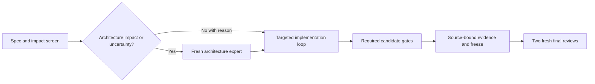
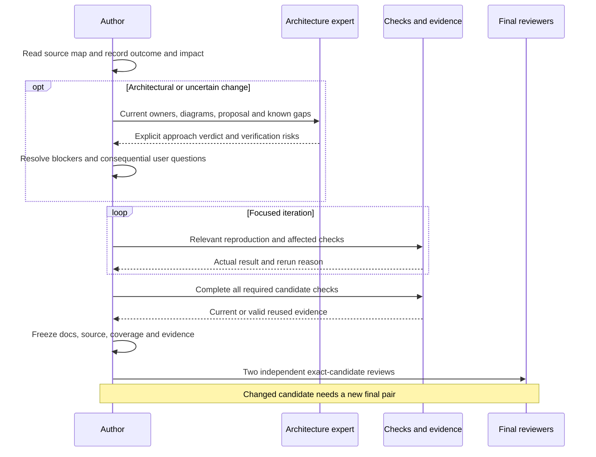

# Daily architecture screen and coding practice

[Code map and atlas](../README.md) | [Owning coding practice](../../CODING_PRACTICE.md)

## Scope and source

Source owners: [Coding practice](../../CODING_PRACTICE.md), [workflow](../../WORKFLOW.md) and [architecture skill](../../../.agents/skills/architecture-review/SKILL.md). This page describes current source and intended
contracts; adopting projects must verify their own adapters and product behavior.

## Component overview

## Representative sequence

## Change and verification boundaries

No test gate is removed for speed. Reuse requires source/test/configuration compatibility; any candidate content change invalidates final approvals. Architecture preflight is an actual agent-session review, not an unauthenticated unattended CI reviewer.

See [requirements and gaps](../../requirements.json); diagrams and syntax validation
do not establish runtime correctness or measured performance.
