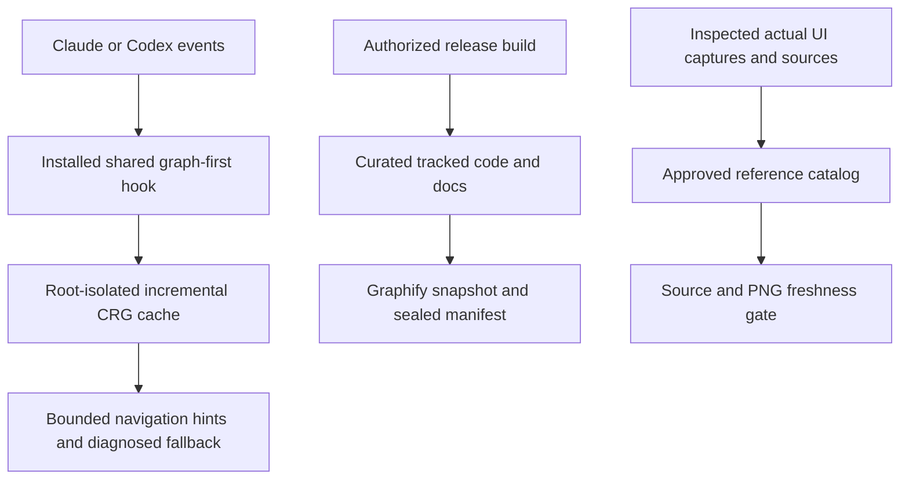
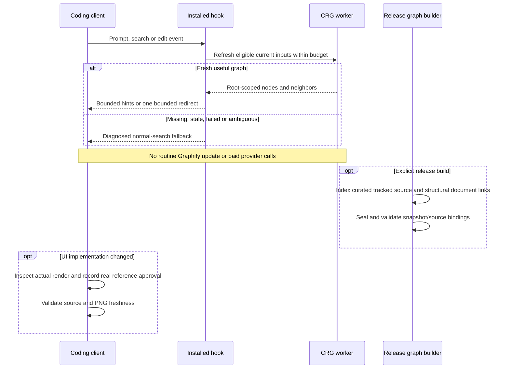

# Development graph, release graph and UI references

[Code map and atlas](../README.md) | [Owning contract](../../specs/graph-first.md)

## Scope and source

Source owners: [graph hook](../../../tools/graph_first.py), [worker](../../../tools/graph_worker.py), [release graph](../../../tools/graph_release.py) and [reference gate](../../../tools/ui_reference.py). This page describes current source and intended
contracts; adopting projects must verify their own adapters and product behavior.

## Component overview

## Representative sequence

## Change and verification boundaries

Current CRG is navigation context, Graphify is an immutable release snapshot, and UI references are approved artifacts; none substitutes for another. Exclude local config, screenshots/evidence and generated/vendor files from graph inputs. Do not auto-approve a changed render or install Graphify watch/git hooks.

See [requirements and gaps](../../requirements.json); diagrams and syntax validation
do not establish runtime correctness or measured performance.
