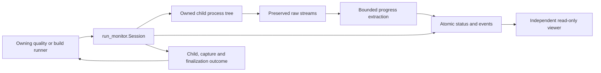
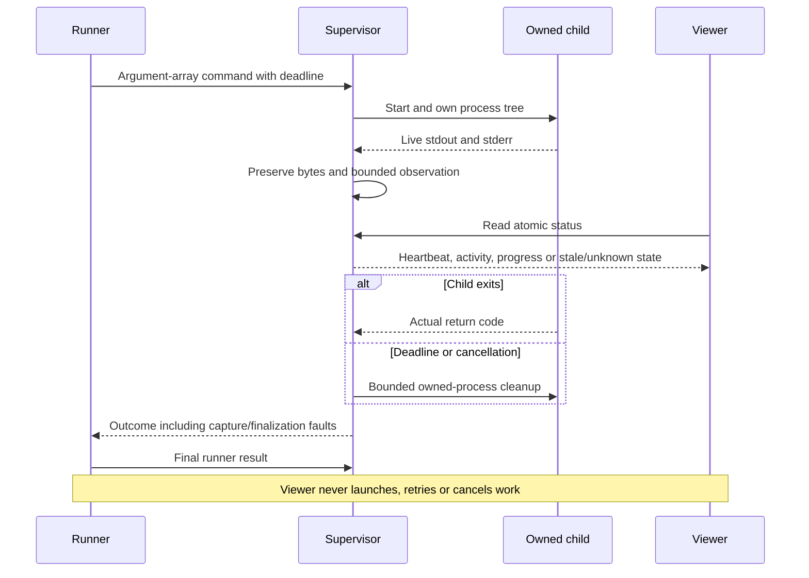

# Local command supervision and read-only observation

[Code map and atlas](../README.md) | [Owning contract](../../specs/local-monitoring.md)

## Scope and source

Source owners: [run_monitor](../../../tools/run_monitor.py), [quality adapter](../../../tools/quality.py) and [project configuration](../../../tools/project.py). This page describes current source and intended
contracts; adopting projects must verify their own adapters and product behavior.

## Component overview

## Representative sequence

## Change and verification boundaries

Quality/build runners decide acceptance, including final monitoring faults. Heartbeat is not test progress or success. Windows process jobs and POSIX cleanup need their own platform verification; a generic adapter adds no product/device recovery unless explicitly implemented.

See [requirements and gaps](../../requirements.json); diagrams and syntax validation
do not establish runtime correctness or measured performance.
