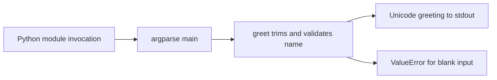
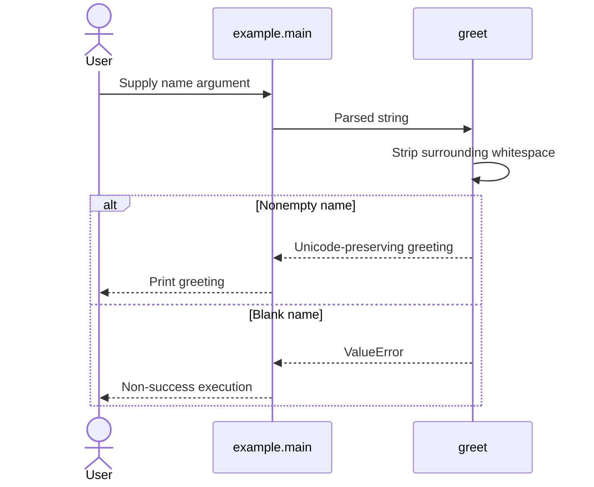

# Reference CLI

[Code map and atlas](../README.md) | [CLI requirement FR-001](../../../SPEC.md#requirements)

## Scope and source

Source owners: [Example source](../../../src/example.py) and [behavior tests](../../../tests/test_example.py). This page describes current source and intended
contracts; adopting projects must verify their own adapters and product behavior.

## Component overview

## Representative sequence

## Change and verification boundaries

No storage or network dependency exists. This behavior is replaceable; adapt actual commands/tests/requirements and packaging together. Do not claim the CLI is an Android app or a UI reference.

See [requirements and gaps](../../requirements.json); diagrams and syntax validation
do not establish runtime correctness or measured performance.
