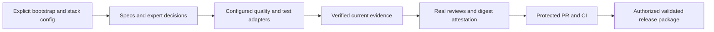
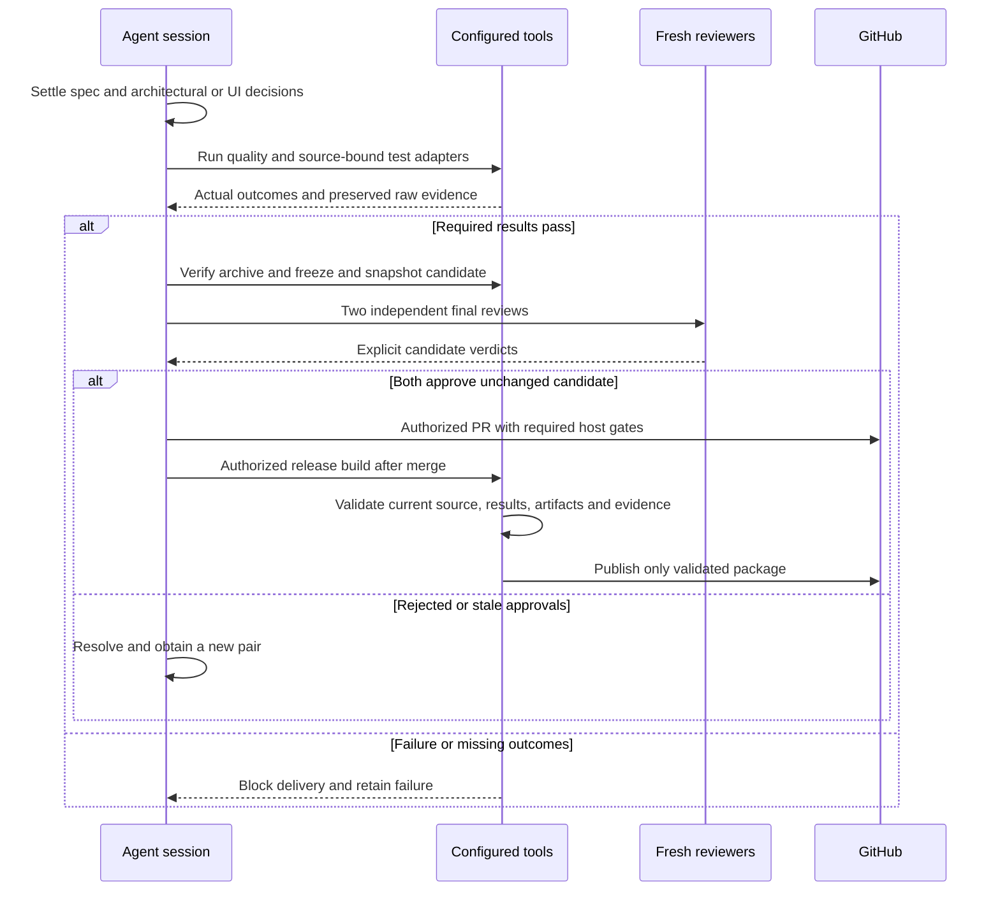

# Reusable setup, verification and release lifecycle

[Code map and atlas](../README.md) | [Owning contract](../../specs/workflow.md)

## Scope and source

Source owners: [bootstrap](../../../tools/bootstrap.py), [quality](../../../tools/quality.py), [review gate](../../../tools/review_gate.py), [evidence](../../../tools/evidence.py) and [release](../../../tools/release.py). This page describes current source and intended
contracts; adopting projects must verify their own adapters and product behavior.

## Component overview

## Representative sequence

## Change and verification boundaries

Initialization invalidates inherited approvals and does not grant account permission. Release validation runs before publication API mutations and never overwrites published versions. Architecture/UI preflights and final reviewers are distinct roles; CI cannot authenticate their identities.

See [requirements and gaps](../../requirements.json); diagrams and syntax validation
do not establish runtime correctness or measured performance.
