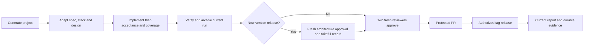

# Feature Specification: Reusable workflow lifecycle

**Status**: Contract for the initial template. **Input**: Reuse a verified workflow.

## User Scenarios & Testing

### User Story 1 — Deliver an inspectable change (Priority: P1)

Given a generated project, when requirements are settled and implementation/tests
are complete, then current quality/evidence plus two fresh approvals permit an
authorized protected PR. Independent tests inject stale mappings, changed candidates,
unsafe/corrupt evidence and missing results; every gate must fail observably.

### User Story 2 - Understand architecture before implementation (Priority: P1)

**Independent Test**: Walk through a local text fix, a changed command/result
contract and uncertain process-lifetime impact using the atlas and expert skill.

**Acceptance Scenarios**:

1. Given a feature owner, when planning a task, then source owners, overview and
   sequence are linked from the atlas. New product owners extend both indexes.
2. Given possible or uncertain architectural impact, when planning implementation,
   then a fresh expert inspects source/invariants/alternatives/failure paths and
   records an explicit approach verdict before dependent work.
3. Given local work, when screening impact, then N/A has a reason; material
   departures re-open expert review. UI and final reviewers remain separate.

### Edge Cases

Material ambiguity waits for the user; exact authorized corrections do not repeat
permission. Unavailable agents/archives/devices stay explicit gaps. Historical
template approval records cannot approve changed project setup.

## Requirements

### Functional Requirements

FR-001 through FR-003, NFR-001 through NFR-007 and NFR-010 (WF-ARCH-001) are owned by [SPEC](../../SPEC.md).
Use [the coverage inventory](../coverage.md) for concrete checks, dimensions and gaps.

### Key Entities

Project configuration, observable requirement, candidate, raw run, release package.

## Feature flow

Owning components and boundaries: [architecture](../ARCHITECTURE.md).

## Success Criteria

### Measurable Outcomes

Fresh setup executes documented checks; fault fixtures block stale/unverified
publication; real reports state their scope and counts without app/device claims.

## Assumptions

Agent sessions and project-specific stack adapters remain explicit prerequisites.

## Implementation diagrams

[Component overview and representative sequence](../architecture/features/workflow.md)
map source ownership, failure/lifecycle boundaries and verification limits.

## Evidence privacy acceptance

- Given raw tracked test screenshots/logs, the host privacy gate fails.
- Given contaminated current host inputs, packaging/upload is withheld.
- Given safe current host reports, the guard permits existing packaging.
- Given explicit privacy withdrawal, unavailable evidence is not counted as verified;
  retained records still fail on missing, changed, duplicate or unsafe paths.

See [privacy boundary](../PRIVACY.md) and the stable privacy requirement mapping.

## Architecture approval for every release

- Given any new version candidate (including patch, prerelease or docs-only), after
  candidate checks/evidence, a fresh read-only architecture expert inspects the
  cumulative diff since the previous published release and current whole-product
  architecture, source, diagrams, known failures and verification gaps.
- Given a task-level N/A or earlier implementation architecture preflight, release
  architecture review is still required and cannot replace either final reviewer.
- Given missing approval or unresolved blockers, the agent must not create/push
  the release tag, dispatch release, sign or publish.
- Given the exact frozen pre-attestation snapshot, the record names actual reviewer,
  UTC date, version, prior release, scope, findings, verdict and residual gaps.
  Final reviewers verify that only faithful architecture attestation was added,
  then approve the final canonical digest including that record. Any other changed
  input needs renewed architecture review; final changes require a new final pair.
- Given an interrupted transport retry of the same version and byte-identical
  candidate, record its identity/retry reason before reusing the actual verdict.
  Never overwrite an already published release or weaken existing retry rules.

This is a required agent-session review, not a newly implemented CI judgment gate.
See [release procedure](../RELEASING.md#release-architecture-review).
