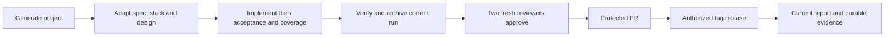

# Feature Specification: Reusable workflow lifecycle

**Status**: Contract for the initial template. **Input**: Reuse a verified workflow.

## User Scenarios & Testing

### User Story 1 — Deliver an inspectable change (Priority: P1)

Given a generated project, when requirements are settled and implementation/tests
are complete, then current quality/evidence plus two fresh approvals permit an
authorized protected PR. Independent tests inject stale mappings, changed candidates,
unsafe/corrupt evidence and missing results; every gate must fail observably.

### Edge Cases

Material ambiguity waits for the user; exact authorized corrections do not repeat
permission. Unavailable agents/archives/devices stay explicit gaps. Historical
template approval records cannot approve changed project setup.

## Requirements

### Functional Requirements

FR-001 through FR-003 and NFR-001 through NFR-007 are owned by [SPEC](../../SPEC.md).
Use [the coverage inventory](../coverage.md) for concrete checks, dimensions and gaps.

### Key Entities

Project configuration, observable requirement, candidate, raw run, release package.

## Feature flow

Owning components and boundaries: [architecture](../ARCHITECTURE.md).

## Success Criteria

### Measurable Outcomes

Fresh setup executes documented checks; fault fixtures block stale/unverified
publication; real reports state their scope and counts without app/device claims.

## Assumptions

Agent sessions and project-specific stack adapters remain explicit prerequisites.
